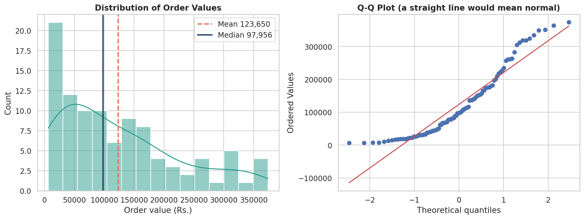
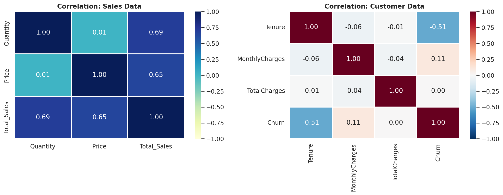
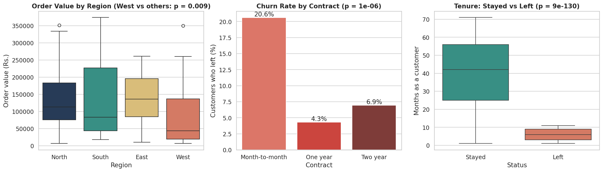
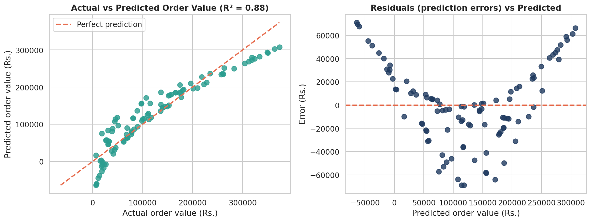

# Statistical Business Analysis

## Project Overview
This project applies statistics to business data to answer practical questions with evidence. It uses a sales dataset (100 orders, January to April 2024) and a customer churn dataset (500 customers). It covers descriptive statistics, a check of the data distribution, correlation analysis, 10 hypothesis tests, 95% confidence intervals and regression analysis, and it translates the results into business recommendations.

Note: the project brief mentions marketing spend and revenue. The datasets contain no marketing-spend column, so that relationship was not analysed and no data was invented. The correlation and regression work uses the business metrics that exist in the data.

## Setup Instructions
1. Install Python 3 from python.org (or use Google Colab, which needs no installation).
2. Install the libraries with: pip install -r requirements.txt
3. Open statistical_analysis.ipynb in Google Colab (colab.research.google.com).
4. Run the first cell and upload two files together: the sales data and customer_churn.csv (download customer_churn.csv from the Developers Arena Week 7 task page).
5. The notebook recognises the sales file by the word "sales" in its file name. business_data.csv is the same sales file, so rename it to sales_data.csv before uploading it to the notebook.
6. Run the remaining cells in order. The charts are saved in a figures folder and the results are written to hypothesis_tests_results.txt.

## Code Structure
- statistical_analysis.ipynb : the full analysis notebook (4 steps: descriptive statistics, correlation and hypothesis tests, confidence intervals and regression, results file)
- business_data.csv : the sales data (100 orders, 7 columns)
- statistical_report.pdf : the written report with methodology, results interpretation and recommendations
- hypothesis_tests_results.txt : the full text results of every test and calculation
- requirements.txt : the libraries needed (pandas, numpy, scipy, statsmodels, matplotlib, seaborn)
- figures/ : the 4 charts created by the notebook

## Visual Documentation

Distribution of order values (histogram and Q-Q plot):

Correlation heatmaps (sales data and customer data):

The main hypothesis tests:

Regression (actual vs predicted, and residuals):

## Technical Details
- Descriptive statistics: mean, median, mode, standard deviation, variance, range, quartiles, IQR, skewness and kurtosis.
- Distribution check: histogram, Q-Q plot and the Shapiro-Wilk normality test.
- Correlation: Pearson and Spearman coefficients (with p-values) and the covariance matrix.
- Hypothesis tests (alpha = 0.05): Welch t-tests, one-way ANOVA (with Kruskal-Wallis and Mann-Whitney as non-parametric checks) and chi-square tests of independence, with Cohen's d as the effect size.
- Multiple tests: a Bonferroni correction (p-value x 10) because 10 tests were run.
- Confidence intervals (95%): t-intervals for means, a Welch interval for a difference between groups, and Wilson intervals for proportions.
- Regression: ordinary least squares (statsmodels) with R-squared, coefficient confidence intervals and a residual check, plus a log-log model.

## Key Results
- Average order: Rs.123,650 (95% CI Rs.103,776 to Rs.143,525). Median Rs.97,956. Order values are skewed to the right and not normally distributed (Shapiro-Wilk p = 1.3e-06).
- Correlation: order value is strongly linked with quantity (r = 0.69) and price (r = 0.65). Quantity and price are not linked with each other (r = 0.01). Tenure and churn are moderately linked (r = -0.51).

| Test | Question | p-value | Adjusted p (x10) | Result |
|---|---|---|---|---|
| 1 | West orders vs other regions | 0.0089 | 0.089 | Significant, but not after correction |
| 2 | Laptop orders vs other products | 0.061 | 0.61 | Not significant |
| 3 | ANOVA across 5 products | 0.093 | 0.93 | Not significant |
| 4 | ANOVA across 4 regions | 0.097 | 0.97 | Not significant |
| 5 | Churn vs contract type | 9.6e-07 | 9.6e-06 | Significant, survives correction |
| 6 | Tenure of customers who left vs stayed | 9e-130 | 9e-129 | Significant, survives correction |
| 7 | Monthly charges of customers who left vs stayed | 0.010 | 0.10 | Significant, but not after correction |
| 8 | Churn vs payment method | 0.144 | 1.0 | Not significant |
| 9 | Churn vs paperless billing | 0.829 | 1.0 | Not significant |
| 10 | Churn vs senior citizen | 0.795 | 1.0 | Not significant |

- Churn: overall 10.6% (95% CI 8.2% to 13.6%). Month-to-month contracts 20.6%, one year 4.3%, two year 6.9%.
- Regression: Total_Sales = -121,682 + 26,431 x Quantity + 4.61 x Price, with R-squared = 0.884. Each extra unit adds about Rs.26,431 to an order.
- Total_Sales is exactly Quantity x Price in every row, so the regression mostly confirms how the data was recorded. A straight-line model cannot copy a multiplication, which is why its R-squared is 0.88 and not 1.0 and its residuals form a curve. A log-log model fits perfectly (R-squared = 1.0).

## Business Recommendations
1. Focus retention on the first 12 months: 63% of customers with 12 months or less of tenure left, against 0% of customers with longer tenure (strong evidence).
2. Encourage month-to-month customers to move to one-year contracts, because their churn rate is 20.6% against 4.3% (strong evidence).
3. Investigate the West region, whose orders are smaller on average (Rs.81,689 against Rs.138,394), but collect more data first: the result does not survive the multiple-test correction (suggestive only).
4. Review pricing for new customers, because customers who left paid more per month, a small effect that also did not survive correction (suggestive only).
5. Record marketing spend so that its effect on revenue can be tested, and collect at least a year of orders.

## Testing Evidence
- Data checks: 0 missing values and 0 duplicate rows in both files.
- Normality was tested (Shapiro-Wilk), and non-parametric tests (Mann-Whitney and Kruskal-Wallis) were used as checks on the t-tests and ANOVA.
- All 10 test results were printed with their hypotheses, p-values, decisions and plain-language meaning, and saved in hypothesis_tests_results.txt.
- A Bonferroni correction was applied: only the churn-vs-contract and tenure results stay significant.
- A residual check showed that the straight-line regression is only an approximation, and a log-log model was fitted to confirm this.
- The notebook runs from top to bottom without errors.

## Limitations
- Only 100 orders over about three months (April has only 9 days), so small differences are hard to detect.
- The customer file and the sales file cannot be matched customer by customer, because their customer IDs use different formats. They were analysed separately.
- TotalCharges in the customer file is unrelated to tenure and monthly charges (correlation about -0.04), so it looks unreliable and was not used.
- Correlation and regression show association, not cause and effect.

## What I Learned
I learned how to calculate and interpret descriptive statistics, check whether data is normally distributed, measure correlation, run and read hypothesis tests, build confidence intervals, and fit and check a regression model. I also learned that running many tests can produce results that look significant by chance, and that a good analysis reports weak evidence honestly.
